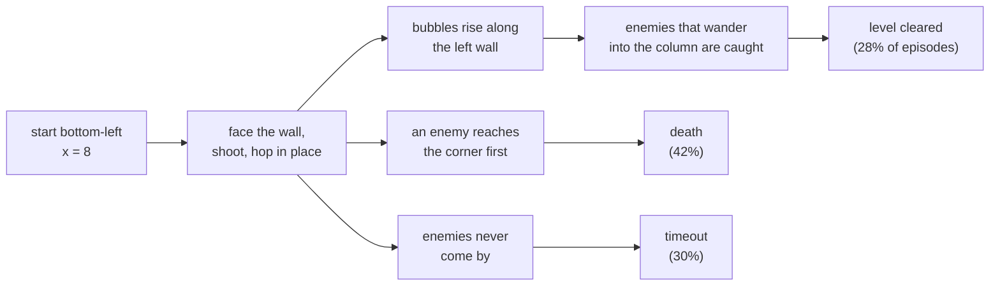

# Behaviour analysis of the all-levels agents

Produced with `scripts/analyze.py` (raw numbers in `runs/analysis/*.json`).
Unless stated, figures are for the evolution champion `g3m05` over
100 levels x 5 episodes, 1 life, one-minute cap, sampled actions.

## The headline: the agent is a turret

The multi-level agents never move sideways. The player starts at the
bottom-left (x = 8) and the agent stays within a few pixels of that spot for
the whole episode, in cleared episodes too. It faces the left wall 97-99% of
the time, so its bubbles form right where it stands and ride the air currents
up the left edge. It jumps (the champion stays between y = 27 and 52) and
shoots, and otherwise waits for enemies to come to it.

| Model | Mean x | Facing left | Horizontal movement |
|---|---|---|---|
| Baseline (all levels, 50M) | 4.1 | 97% | none |
| Champion `g3m05` | 4.1 | 99% | none |
| Level-1 specialist (`ppo_state_L1_v2`) | 79.0 | 1% | crosses the screen |

This explains most of the other findings: which levels get cleared is a
property of whether that level's enemies path through the bottom-left column,
not of anything the agent decides. A direct check: simulating each level for
four minutes with an immortal, idle player and measuring how much time enemies
spend in the leftmost 16 pixels:

| Enemy time in the left column | Levels | Champion clears (of 5) | Never cleared |
|---|---|---|---|
| under 5% | 20 | 0.00 | 20 of 20 |
| 5-10% | 8 | 1.12 | 4 |
| 10-20% | 31 | 1.26 | 18 |
| over 20% | 41 | 2.27 | 14 |

Every level whose enemies rarely visit the corner is never cleared. It is also why the agent's play looked
"weird and non-human" in the galleries.

The level-1 specialist moves normally. Training on all 100 levels at once
found this camping policy instead, and the evolutionary search then refined
it rather than escaping it.

## How episodes end

| Outcome | Baseline | Champion |
|---|---|---|
| Cleared | 22% | 28% |
| Died | 34% | 42% |
| Timed out | 44% | 30% |

The champion converted timeouts into both clears and deaths: it is a more
active turret, not a different strategy.

**Deaths** (champion, 211 of 500 episodes): 41% before it has killed anything,
and most within the first 15 seconds. The killer is only an angry enemy in
17% of cases; the rest are ordinary enemies arriving at the corner.

| Time of death | Baseline | Champion |
|---|---|---|
| under 5 s | 25 | 25 |
| 5-15 s | 79 | 88 |
| 15-30 s | 36 | 55 |
| over 30 s | 31 | 43 |

Which kinds kill, per 100 of that kind in play: hidegonsu 9.8, invader 8.8,
buster 8.7, stoner 7.9, hullaballoon 6.8, beluga 6.3, drunk 4.2, banebou 1.6.
(Six of the eight kinds are stand-ins that reuse the buster or beluga logic,
so this mostly measures spawn positions and counts.)

**Timeouts** (148): the player never moved in any of them; 54 had no kill at
all, and the typical timeout still had 3-5 enemies alive. Longer episodes
help only a little:

| Cap | Cleared | Died | Timed out |
|---|---|---|---|
| 30 s | 24% | 29% | 47% |
| 60 s | 28% | 42% | 30% |
| 120 s | 32% | 43% | 26% |
| 240 s | 35% | 41% | 25% |

## What the agent uses from its observation

Zeroing parts of the 616-number input at play time (champion, 500 episodes):

| Inputs removed | Cleared | Died | Timed out |
|---|---|---|---|
| nothing | 141 | 211 | 148 |
| in-flight bubbles | 147 | 190 | 163 |
| bubbles | 127 | 162 | 211 |
| enemies | 125 | 122 | 253 |
| loot (fruit, pickups) | 123 | 140 | 237 |
| tile grid | 21 | 363 | 116 |
| currents (grid as wall/air) | 82 | 244 | 174 |

- The grid is the one input it cannot do without. For a stationary agent the
  grid is effectively a level ID, so this suggests it has memorised per-level
  timing rather than reading geometry.
- Removing enemies or loot makes it die *less* and time out more. Its
  reactions to enemies and fruit are often what gets it killed; blind, it
  simply waits. In-flight bubble info is irrelevant.
- The currents row is a distribution shift (air tiles change value), so it
  overstates how much the currents themselves matter.

## Which levels get cleared

Clear rate by level feature (champion):

| Feature | Clear rate |
|---|---|
| sparse walls (< 20% of interior) | 37% (60 levels) |
| medium walls (20-35%) | 17% (37 levels) |
| dense walls (35%+) | 0% (3 levels) |
| only floaters | 36% (18 levels) |
| no floaters | 30% (65 levels) |
| mixed | 14% (17 levels) |
| 2-3 enemies | 40% (5 levels) |
| 4-5 enemies | 28% (21 levels) |
| 6+ enemies | 28% (74 levels) |

Enemy count barely matters, wall density does: open layouts let enemies and
bubbles reach the left column. 56 levels were never cleared in 5 tries; 13
were cleared every time (1, 2, 8, 14, 19, 23, 25, 34, 36, 57, 68, 76, 86).
Against the baseline the champion is clearly better on 10 levels and clearly
worse on 2.

## What the evolutionary search learned

Each child compared with its own parent on the same seeds (episodes cleared
out of 500; re-scoring the same model on new seeds moves it by about 10):

| Mutation | n | Mean change |
|---|---|---|
| entropy coefficient down | 4 | +7 |
| clear bonus down (reverting) | 11 | +2 |
| learning rate down | 8 | +2 |
| unmutated continuation | 22 | -3 |
| time penalty down | 14 | -11 |
| entropy coefficient up | 9 | -20 |
| death penalty down | 10 | -28 |
| time penalty up | 22 | -30 |
| clear bonus up | 24 | -32 |
| learning rate up | 7 | -33 |
| pop reward off | 12 | -53 |

Plain continuation did nothing; every reward change hurt; only a lower
learning rate and selection helped. In generation 3 the models with learning
rate under 1e-4 averaged 128 cleared, 1e-4 to 2e-4 averaged 117, and above
2e-4 averaged 99.

## Experiments prompted by this

All scored on fresh seeds, 100 levels x 10 episodes, one-minute cap, from the
normal start. Reference: baseline 217 / 1000, champion `g3m05` 302 / 1000.

| Experiment | Cleared / 1000 | Died | Timed out | Moves? |
|---|---|---|---|---|
| **Control**: baseline + 30M steps at lr 1.5e-4, no selection | 211 | 412 | 377 | no (x = 4) |
| **Random start**: champion + 30M steps with `--random-start` | 167 | 585 | 248 | no (x = 4) |
| **From the mover**: level-1 specialist + 30M steps on all levels | 59 | 622 | 319 | yes (x up to 84) |
| Level-1 specialist as is, for reference | 70 | 684 | 246 | yes |

- **The champion's gain came from selection, not the learning rate.** The
  control, which is exactly the champion's recipe minus the selection step,
  scores the same as the baseline (211 vs 217). The evolutionary loop earned
  its +85.
- **Random starts did not teach movement.** Trained from random platforms, the
  agent still walks to a wall and camps; from the normal start it is worse than
  before (167), and under random starts it clears 44 / 300 against 45 for the
  control, so it gained nothing from the training condition either.
- **A moving agent does not become a good one in 30M steps.** Starting from the
  level-1 specialist keeps the movement (it still crosses the screen) but it
  dies in 62% of episodes and ends up below the camping agents. Camping is not
  an accident of the start position: it is the easier policy for this
  network to find across 100 layouts.

Two follow-ups, same scoring:

| Experiment | Cleared / 1000 | Died | Timed out | Moves? |
|---|---|---|---|---|
| **Mover, 100M steps**: level-1 specialist + 100M on all levels | 116 | 293 | 591 | **no** (x = 4) |
| **Random start from scratch**: MLP, 50M steps with `--random-start` | 15 | 923 | 62 | yes (x std 26) |

- **Camping is an attractor.** Given 100M steps instead of 30M, the moving
  specialist did not get better at moving: it stopped moving. By the end it
  stands at the spawn point facing the wall 99% of the time, exactly like the
  agents trained from scratch, and is worse than the baseline because it
  camps less effectively.
- **Forcing movement from the start gives an agent that moves and dies.**
  Trained from random platforms from scratch, the agent crosses the screen but
  dies in 92% of episodes from the normal start.

So within this network and training setup, every road leads to the corner.
The likeliest reason it is such a good corner: six of the eight enemy kinds
are stand-ins without their projectiles (`game.py`). In the real game a
Stoner's rocks, a Hidegonsu's fireballs or an Invader's lasers would punish a
stationary player; here nothing does, so standing in a spot that enemies walk
into while bubbles rise around you is close to optimal. Implementing the
projectile enemies is probably the single change most likely to produce an
agent that plays like a person, and it is a fidelity fix rather than an RL
trick.

A different network does not change the picture either. `--arch conv` (a
small CNN over the 16 x 24 grid plus an MLP over the rest, about 500k
parameters, from scratch, 50M steps):

| Experiment | Cleared / 1000 | Died | Timed out | Moves? |
|---|---|---|---|---|
| conv, normal start | 151 | 227 | 622 | no (x = 4) |
| conv, `--random-start` | 6 | 912 | 82 | yes (x std 24) |
| MLP baseline, same budget, for reference | 217 | 317 | 466 | no |

The conv agent camps like the MLP and is worse at it (the CNN also trains
about seven times slower on CPU). With random starts it moves and dies, like
its MLP counterpart.

## Summary of the day's experiments

| Lever tried | Result |
|---|---|
| Reward shaping (clear bonus, time penalty, pop reward, death penalty) | all hurt |
| Lower learning rate alone | no change |
| Evolutionary selection (6 generations, 180 fine-tunes) | +85 / 1000, then plateau at ~30% |
| Random start position (fine-tune, from scratch, conv) | moves but dies, or camps anyway |
| Start from a moving agent, 30M or 100M steps | collapses into camping |
| CNN over the grid | camps, slightly worse |

Every agent that scores well stands in the bottom-left corner. The fix is most
likely in the game, not the learner: give the six stand-in enemy kinds their
projectiles so that standing still is punished the way it is in the original.

## After implementing the projectiles (2026-10-06 evening)

All eight enemy kinds now follow `bub_ai.z80`: Stoners throw rocks that roll
until they hit a wall, Hidegonsus shoot fireballs that pass through walls,
Invaders drop lasers on a timer, Drunks throw a boomerang beer and freeze
until it returns, Hullaballoons float faster than Belugas, Banebous bounce.
Every projectile kills the player; bubbles do not stop them.

The camping agents, re-scored in the new game (same fresh seeds, 100 levels
x 10 episodes):

| Model | Old game | New game |
|---|---|---|
| Baseline (`ppo_state_all_50M`) | 217 | 125 |
| Champion `g3m05` | 302 | 131 |
| Level-1 specialist (moves) | 70 | 45 |

The corner is no longer safe: the champion's deaths rose from 378 to 586 and
its clears more than halved. Among the deaths I could attribute, rocks,
lasers and beer each killed more often than enemies did. These models cannot
see projectiles (their observation predates them), so this is a lower bound
on how much the new enemies change the game.

Agents trained in the new game (same scoring; the old baseline made 217 in
the old game at 50M steps):

| Run | Cleared / 1000 | Died | Timed out | Moves? |
|---|---|---|---|---|
| From scratch, 50M, seed 1 | 30 | 656 | 314 | barely (x within 16 px) |
| From scratch, 50M, seed 2 | 12 | 788 | 200 | no |
| From scratch, 50M, seed 3 | 38 | 675 | 287 | no |
| Seed 3 continued to 200M | 115 | 636 | 249 | no (x = 4, facing left 99%) |
| Level-1 mover transplanted, +100M (new inputs start at zero weight) | 108 | 418 | 474 | no (collapsed into camping) |
| Curriculum (pool grows 1 -> 100 levels over 120M of 200M steps) | 5 | 912 | 83 | yes (x std 22) |

Projectiles lowered the ceiling of camping (115 instead of 217) but did not
make movement learnable: the agents that camp still beat the agents that
move by a wide margin, and a moving initialisation collapses into camping
again. The curriculum run learned to move on level 1, then fell apart as the
pool grew (its training return went from 44 at 26M steps to under 10 for
the rest of the run).

So the fidelity fix was necessary but not sufficient. The remaining suspect
is the representation: in the "state" observation every object is an
absolute (x, y) in a fixed slot and the layout is 384 unrelated numbers, so
"a platform two tiles above me with an enemy walking toward me" looks
completely different on every level. A person sees that situation the same
way everywhere.

`obs_type="ego"` (an 11 x 15 tile window centred on the player instead of the
whole grid, every object as its offset from the player), 100M steps each:

| Run | Cleared / 1000 | Died | Timed out | Moves? |
|---|---|---|---|---|
| ego, seed 1 | 36 | 820 | 144 | no |
| ego, seed 2 | 23 | 887 | 90 | yes (x std 35), and dies |
| ego + curriculum | 93 | 657 | 250 | mostly camps, occasional excursions |

The egocentric view did not produce a moving agent that survives either. The
two outcomes are the same as before: camp, or move and die. Training returns
were low and noisy throughout, so this is not a case of a good policy that
needs more steps; nothing was converging.

## Where this leaves things (2026-10-07)

Across two days: about 1.5 billion agent steps, 7 ideas, 3 observation
designs, 2 architectures. The reimplementation now has all eight enemy kinds
with projectiles, and the camping exploit is weaker than it was, but no
training recipe tried here learns to move *and* survive across 100 layouts.
The best scores in the current game are still campers (115 / 1000).

What has not been tried, roughly in order of how likely it is to work:

1. **Learning from Scott's own play.** Record button presses while playing
   (`play.py` already has the loop), then pretrain the policy by behaviour
   cloning before PPO. Human play is moving play by construction, and PPO
   fine-tuning from a moving policy is a different starting point from the
   ones that collapsed here, because the collapse happened when the policy
   had never been rewarded for moving. A few hundred human episodes is enough
   for a first attempt.
2. **Memory.** The policy has none: with sampled actions and no recurrence it
   cannot commit to "go right until the gap", which is what moving across a
   level requires. A GRU over the ego observation is the standard fix.
3. **A much bigger budget.** Atari-style agents use hundreds of millions to
   billions of frames with much larger networks; these runs used 4-16M
   frames per level-equivalent.
4. **Fewer levels.** An agent for 10 levels would show whether the method
   works at all before scaling to 100.

## Punishing time and standing still (2026-10-08/09)

Scott asked for a heavier time penalty, a light penalty for standing still,
and to keep the bubble-climbing (jumping up a wall on a column of bubbles)
that the agents had started to show, as something they do in bursts rather
than all the time. `stationary_penalty` was added to the env: a per-step
charge whenever the player's x has stayed inside a band for a window of
steps. Four rounds, all in the game with projectiles, scored on the usual
fresh seeds (100 levels x 10 episodes) with `scripts/analyze.py`'s new
behaviour profile (3 episodes per level). "Bouncer" is the best camper
fine-tuned under the new penalties; "mover" is the agent the stationary
penalty first set in motion.

| Round | Death penalty | Still-penalty band | Run | Cleared / 1000 | x range | Bounces / min | Crosses screen |
|---|---|---|---|---|---|---|---|
| 1 | 1 | 8 px / 2 s | time 0.01 only, scratch 100M | 62 | 5 px | 26.5 | 0 / 300 |
| 1 | 1 | 8 px / 2 s | + still 0.005, scratch 100M | 8 | 58 px | 19.4 | 180 / 300 |
| 1 | 1 | 8 px / 2 s | + still 0.01, scratch 100M | 4 | 54 px | 28.5 | 148 / 300 |
| 1 | 1 | 8 px / 2 s | camper fine-tuned 50M ("bouncer") | 122 | 7 px | 20.8 | 0 / 300 |
| 2 | 15 | 8 px / 2 s | scratch 100M | 54 | 7 px | 0.0 | 0 / 300 |
| 2 | 15 | 8 px / 2 s | from the mover 50M | 38 | 49 px | 0.0 | 139 / 300 |
| 2 | 15 | 8 px / 2 s | from the bouncer 50M | 120 | 6 px | 0.2 | 0 / 300 |
| 2 | 15 | 8 px / 2 s | ego obs, scratch 100M | 68 | 7 px | 3.6 | 0 / 300 |
| 3 | 5 | 8 px / 2 s | scratch 100M | 65 | 8 px | 5.7 | 0 / 300 |
| 3 | 5 | 8 px / 2 s | from the mover 50M | 74 | 11 px | 0.0 | 0 / 300 |
| 3 | 5 | 8 px / 2 s | from the bouncer 50M | 126 | 9 px | 26.5 | 0 / 300 |
| 3 | 5 | 8 px / 2 s | ego, continued 50M | 114 | 9 px | 1.6 | 0 / 300 |
| 4 | 5 | 32 px / 8 s | scratch 100M | 35 | 6 px | 21.3 | 1 / 300 |
| 4 | 5 | 32 px / 8 s | from the mover 50M | 68 | 3 px | 0.0 | 0 / 300 |
| 4 | 5 | 32 px / 8 s | from the bouncer 50M | **141** | 3 px | **26.9** | 0 / 300 |
| 4 | 5 | 32 px / 8 s | ego, continued 50M | 123 | 6 px | 17.2 | 0 / 300 |

All rounds use time penalty 0.01 (five times the earlier 0.002) and
stationary penalty 0.005 unless stated.

What happened, round by round:

1. **The heavier time penalty brought the climbing.** Bubble bounces went
   from 3 a minute (the old camper) to 20-28 in every run, and the fine-tuned
   camper became the best agent in the game. **The stationary penalty did
   make agents move**, crossing the screen in half to two-thirds of
   episodes, but they died within seconds: median death at 4 s, 60% of
   actions RIGHT. With per-step charges of 0.015 and a death penalty of 1,
   a minute alive costs 13.5 and dying costs 1, so running into the first
   enemy was the optimal policy. A reward bug, not a behaviour.
2. **Death penalty 15 fixed the suicide and killed the climbing.** Bounces
   dropped to zero; with death that expensive a jump is a risk not worth
   taking. And a new loophole: agents travelled 350-650 px per episode
   while staying within 7 px, wiggling in place to dodge the "still" charge.
3. **Death penalty 5 restored the climbing** (bouncer: 26.5 bounces/min, 126
   cleared) but every run, including the former mover, settled into
   wiggling.
4. **A band wiggling cannot satisfy** (32 px of range over 8 s) ended the
   wiggling, and the agents simply paid the penalty instead: 91-94% of
   steps still, x range 3-6 px. The bouncer improved again (141 cleared, 27
   bounces/min, 46 px of vertical range); the mover gave up moving and
   jumping both.

So the two asks pull against each other at these strengths. A stationary
penalty light enough to leave the climbing alone is also light enough to
ignore; one heavy enough to force movement produces running and dying,
because a moving policy that survives has still not been learned by any
method tried here. The time penalty, on the other hand, did exactly what
was hoped: the best agent now climbs its bubble columns constantly
(gallery: `exports/v6_bouncer_band32/index.html`), and it is the strongest
agent in the current game at 141 / 1000.

Not tried: a stationary penalty in the 0.02-0.05 range with death penalty 5
(would force movement, probably at the cost of the climbing and of clears);
rewarding distance covered rather than charging for its absence; and the
imitation route from the previous section, which remains the most likely way
to get a moving agent that survives.
