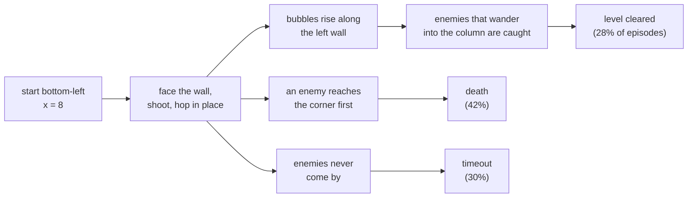

# Behaviour analysis of the all-levels agents

Produced with `scripts/analyze.py` (raw numbers in `runs/analysis/*.json`).
Unless stated, figures are for the evolution champion `g3m05` over
100 levels x 5 episodes, 1 life, one-minute cap, sampled actions.

## The headline: the agent is a turret

The multi-level agents never move sideways. The player starts at the
bottom-left (x = 8) and the agent stays within a few pixels of that spot for
the whole episode, in cleared episodes too. It faces the left wall 97-99% of
the time, so its bubbles form right where it stands and ride the air currents
up the left edge. It jumps (the champion stays between y = 27 and 52) and
shoots, and otherwise waits for enemies to come to it.

| Model | Mean x | Facing left | Horizontal movement |
|---|---|---|---|
| Baseline (all levels, 50M) | 4.1 | 97% | none |
| Champion `g3m05` | 4.1 | 99% | none |
| Level-1 specialist (`ppo_state_L1_v2`) | 79.0 | 1% | crosses the screen |

This explains most of the other findings: which levels get cleared is a
property of whether that level's enemies path through the bottom-left column,
not of anything the agent decides. It is also why the agent's play looked
"weird and non-human" in the galleries.

The level-1 specialist moves normally. Training on all 100 levels at once
found this camping policy instead, and the evolutionary search then refined
it rather than escaping it.

## How episodes end

| Outcome | Baseline | Champion |
|---|---|---|
| Cleared | 22% | 28% |
| Died | 34% | 42% |
| Timed out | 44% | 30% |

The champion converted timeouts into both clears and deaths: it is a more
active turret, not a different strategy.

**Deaths** (champion, 211 of 500 episodes): 41% before it has killed anything,
and most within the first 15 seconds. The killer is only an angry enemy in
17% of cases; the rest are ordinary enemies arriving at the corner.

| Time of death | Baseline | Champion |
|---|---|---|
| under 5 s | 25 | 25 |
| 5-15 s | 79 | 88 |
| 15-30 s | 36 | 55 |
| over 30 s | 31 | 43 |

Which kinds kill, per 100 of that kind in play: hidegonsu 9.8, invader 8.8,
buster 8.7, stoner 7.9, hullaballoon 6.8, beluga 6.3, drunk 4.2, banebou 1.6.
(Six of the eight kinds are stand-ins that reuse the buster or beluga logic,
so this mostly measures spawn positions and counts.)

**Timeouts** (148): the player never moved in any of them; 54 had no kill at
all, and the typical timeout still had 3-5 enemies alive. Longer episodes
help only a little:

| Cap | Cleared | Died | Timed out |
|---|---|---|---|
| 30 s | 24% | 29% | 47% |
| 60 s | 28% | 42% | 30% |
| 120 s | 32% | 43% | 26% |
| 240 s | 35% | 41% | 25% |

## What the agent uses from its observation

Zeroing parts of the 616-number input at play time (champion, 500 episodes):

| Inputs removed | Cleared | Died | Timed out |
|---|---|---|---|
| nothing | 141 | 211 | 148 |
| in-flight bubbles | 147 | 190 | 163 |
| bubbles | 127 | 162 | 211 |
| enemies | 125 | 122 | 253 |
| loot (fruit, pickups) | 123 | 140 | 237 |
| tile grid | 21 | 363 | 116 |
| currents (grid as wall/air) | 82 | 244 | 174 |

- The grid is the one input it cannot do without. For a stationary agent the
  grid is effectively a level ID, so this suggests it has memorised per-level
  timing rather than reading geometry.
- Removing enemies or loot makes it die *less* and time out more. Its
  reactions to enemies and fruit are often what gets it killed; blind, it
  simply waits. In-flight bubble info is irrelevant.
- The currents row is a distribution shift (air tiles change value), so it
  overstates how much the currents themselves matter.

## Which levels get cleared

Clear rate by level feature (champion):

| Feature | Clear rate |
|---|---|
| sparse walls (< 20% of interior) | 37% (60 levels) |
| medium walls (20-35%) | 17% (37 levels) |
| dense walls (35%+) | 0% (3 levels) |
| only floaters | 36% (18 levels) |
| no floaters | 30% (65 levels) |
| mixed | 14% (17 levels) |
| 2-3 enemies | 40% (5 levels) |
| 4-5 enemies | 28% (21 levels) |
| 6+ enemies | 28% (74 levels) |

Enemy count barely matters, wall density does: open layouts let enemies and
bubbles reach the left column. 56 levels were never cleared in 5 tries; 13
were cleared every time (1, 2, 8, 14, 19, 23, 25, 34, 36, 57, 68, 76, 86).
Against the baseline the champion is clearly better on 10 levels and clearly
worse on 2.

## What the evolutionary search learned

Each child compared with its own parent on the same seeds (episodes cleared
out of 500; re-scoring the same model on new seeds moves it by about 10):

| Mutation | n | Mean change |
|---|---|---|
| entropy coefficient down | 4 | +7 |
| clear bonus down (reverting) | 11 | +2 |
| learning rate down | 8 | +2 |
| unmutated continuation | 22 | -3 |
| time penalty down | 14 | -11 |
| entropy coefficient up | 9 | -20 |
| death penalty down | 10 | -28 |
| time penalty up | 22 | -30 |
| clear bonus up | 24 | -32 |
| learning rate up | 7 | -33 |
| pop reward off | 12 | -53 |

Plain continuation did nothing; every reward change hurt; only a lower
learning rate and selection helped. In generation 3 the models with learning
rate under 1e-4 averaged 128 cleared, 1e-4 to 2e-4 averaged 117, and above
2e-4 averaged 99.

## Experiments prompted by this

All scored on fresh seeds, 100 levels x 10 episodes, one-minute cap, from the
normal start. Reference: baseline 217 / 1000, champion `g3m05` 302 / 1000.

| Experiment | Cleared / 1000 | Died | Timed out | Moves? |
|---|---|---|---|---|
| **Control**: baseline + 30M steps at lr 1.5e-4, no selection | 211 | 412 | 377 | no (x = 4) |
| **Random start**: champion + 30M steps with `--random-start` | 167 | 585 | 248 | no (x = 4) |
| **From the mover**: level-1 specialist + 30M steps on all levels | 59 | 622 | 319 | yes (x up to 84) |
| Level-1 specialist as is, for reference | 70 | 684 | 246 | yes |

- **The champion's gain came from selection, not the learning rate.** The
  control, which is exactly the champion's recipe minus the selection step,
  scores the same as the baseline (211 vs 217). The evolutionary loop earned
  its +85.
- **Random starts did not teach movement.** Trained from random platforms, the
  agent still walks to a wall and camps; from the normal start it is worse than
  before (167), and under random starts it clears 44 / 300 against 45 for the
  control, so it gained nothing from the training condition either.
- **A moving agent does not become a good one in 30M steps.** Starting from the
  level-1 specialist keeps the movement (it still crosses the screen) but it
  dies in 62% of episodes and ends up below the camping agents. Camping is not
  an accident of the start position: it is the easier policy for this
  network to find across 100 layouts.

The flat MLP sees the 16 x 24 tile grid as 384 unrelated numbers, which may be
why a moving policy fails to generalise across layouts. Next experiment
(running as of 2026-10-06 midday): `--arch conv`, a small CNN over the grid
plus an MLP over the rest (about 500k parameters), trained from scratch for
50M steps, with and without random starts. Evolution generations 4-6 are also
still running.
