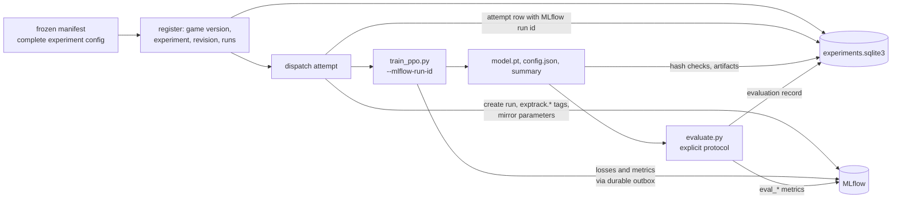

# Experiment tracking

Two stores, each with one job:

- **`experiments.sqlite3`** (repository root, gitignored) is the authoritative
  record of what was run: experiments, immutable revisions, runs with their
  complete effective configurations, attempts, evaluations with their full
  protocol, artifacts and an append-only event history. Schema migrations live in
  `scripts/exptrack/migrations/` and are applied automatically.
- **MLflow** (the service at http://127.0.0.1:5000, backed by `mlflow.db`) holds
  learning curves: losses, entropy, KL, clip fraction, explained variance,
  returns, every reward component, throughput. It also mirrors each run's
  parameters and evaluation results for browsing.

Every MLflow run created by the dispatcher carries `exptrack.*` tags (experiment,
revision, run, attempt and the database path). The SQLite attempt row stores the
MLflow tracking URI, experiment ID and run ID, so either side resolves the other.



## MLflow is mandatory

There is no option to turn tracking off (user instruction, 2026-10-19 21:00).
`--no-mlflow` no longer exists, and configuration files or manifests that set
`no_mlflow` are rejected.

- **Before training.** The trainer resolves the service as `--mlflow-tracking-uri`,
  then `$MLFLOW_TRACKING_URI`, then http://127.0.0.1:5000. It must answer a
  preflight. The run must also be created, or the dispatcher-created run found
  and still open, before any file is written. There is no fallback to the
  `mlflow.db` file.
- **During training.** Each metric event is appended to
  `<run_dir>/mlflow_outbox.jsonl` (flushed and fsynced) and then uploaded. If
  uploads keep failing for about 30 s (retries at 1, 2, 4, 8 and 15 s), the
  trainer raises `TrackingUnavailable` and stops. The MLflow run is then marked
  FAILED if the service allows.
- **At the end.** A run counts as finished only when every event is uploaded and
  the run is marked terminated.
- **Replay.** The outbox provides crash consistency, not an outage mode. After a
  hard failure, `python -m exptrack sync <run_dir>` replays leftover events to
  the same run. Timestamps are fixed when an event is created, so a resend of
  identical rows is ignored by MLflow's store and nothing is duplicated.
- **Tests.** `tests/conftest.py` points `MLFLOW_TRACKING_URI` at a throwaway
  SQLite store for the whole test session, so tests never touch the project's
  service.

## What is recorded

**Experiment level** (`experiment_params`, one typed row per key; full list in
`scripts/exptrack/schema.py`, `EXPERIMENT_SCHEMA`):
- the question;
- game version: name, source hash over the package files, commit;
- the reference recipe and its configuration hash;
- design: type, arms as trainer-key overrides, factors, reference arm, phases;
- the complete shared training configuration;
- seeds per phase and their allocation;
- evaluation protocol: levels, episodes, seed bank per role, roles per phase,
  lives, decision cap and frame skip with the cap in frames, action selection,
  completion definition, metric and version, aggregation, checkpoint;
- search procedure and order;
- budget: hardware, per-run wall minutes per phase, aggregate core-hours,
  whether evaluation counts, concurrency, threads, evaluation and save limits,
  hard cutoff;
- stopping rule, ranking metric and tie-breaks, selection rule, acceptance
  thresholds;
- tracking settings.

The shared configuration and each arm's overrides are also expanded into rows
(`shared.<key>`, `design.arm.<arm>.<key>`) so they can be queried.

**Run level** (`run_params`): all 62 trainer hyperparameters under namespaced
keys:
- `exposure.*`, `task.*`, `reward.*` (every component, weight and gate);
- `observation.*`, `return.*`, `ppo.*`, `optimizer.*`;
- `network.arch` with `network.mlp.hidden`, `network.mlp.layers` and
  `network.mlp.act`;
- `init.*`, `budget.*`, `checkpoint.*`.

Each row has a unit, a provenance (`experiment.shared`, `experiment.arm`,
`experiment.budget`, `run.override`, `historical`) and an active flag. A value
that another setting switches off is kept with `active = 0` and the governing
key; for example, `score_scale` is gated by `score_reward`. Derived facts are
stored too: input size, actual parameter count from the real network, episode
length in seconds and checkpoint policy.

The network is an architecture name plus architecture-specific keys, so a
transformer would add `network.transformer.*` without pretending to have an MLP
width.

**Evaluations** (`evaluations` and `evaluation_params`) record:
- the checkpoint path and hash;
- the full protocol, including observation flags, the game hash and the
  evaluator hash;
- the role (screen, tuning, development, final, paired_test);
- the metric definition and version;
- results, with per-level clears;
- the raw file and its hash.

The dispatcher checks that the evaluator reports the protocol it was asked to
run.

## Invariants

- **Immutable configuration records.** Revisions, runs and parameter rows cannot
  be updated or deleted (triggers enforce this), and events are append-only.
  A change is a new revision or a new run.
- **Idempotent registration.** Registering the same configuration returns the
  existing ID. A different configuration under an existing identity raises
  `ConflictError`.
- **Reconstruction without defaults.** `store.reconstruct_run_config` rebuilds a
  run's trainer configuration from its rows alone and checks it against the
  stored snapshot and hash. The dispatcher hands exactly that file to the
  trainer, then checks that the trainer's `config.json` matches it.
- **Retries keep their identity.** A retry is attempt 2 of the same run, in
  `<job>_a2/`, with its own MLflow run.
- **Concurrency.** WAL, a 30 s busy timeout, foreign keys and `BEGIN IMMEDIATE`
  transactions.

## Commands

```bash
PYTHONPATH=scripts .venv/bin/python -m exptrack show
```

```bash
PYTHONPATH=scripts .venv/bin/python -m exptrack show --experiment capacity-1020
```

```bash
PYTHONPATH=scripts .venv/bin/python -m exptrack params run network.parameter_count
```

```bash
PYTHONPATH=scripts .venv/bin/python -m exptrack import-historical runs/hparam-1019 runs/hparam-1019-v2 runs/paired-1019-v3
```

A registered campaign is frozen first, then preflighted and run from its
snapshot:

```bash
.venv/bin/python scripts/run_hyperparameter_search.py snapshot --root runs/<id> --manifest scripts/campaigns/<id>.json
```

```bash
PYTHONPATH=runs/<id>/snapshot/src:runs/<id>/snapshot/scripts .venv/bin/python -m exptrack campaign preflight --root runs/<id> --db experiments.sqlite3
```

```bash
PYTHONPATH=runs/<id>/snapshot/src:runs/<id>/snapshot/scripts .venv/bin/python -m exptrack campaign run --root runs/<id> --db experiments.sqlite3
```

The campaign runner (`scripts/exptrack/campaign.py`):
- takes an exclusive lock;
- reserves each job's full allowance against the core-hour cap and the hard
  cutoff before dispatch;
- allows at most one infrastructure retry per job, and never a
  performance-based one;
- halts on systemic correctness errors;
- freezes the selection, with all checkpoint hashes, before opening the final
  bank;
- writes `status.json`, `events.log`, `selection.json` and `results.json` next
  to the snapshot.

## Historical campaigns

hparam-1019-v1, hparam-1019-v2 and paired-1019-v3 are imported from their own
records.

- **Runs.** Each run's configuration is the one it recorded. v1's
  pre-no-defaults file is mapped by `hyperparams.from_legacy_run`. Provenance is
  `historical`.
- **Evaluations** come from the raw files. All 176 match the clears the
  campaigns recorded.
- **MLflow.** These campaigns ran with `--no-mlflow`, so no learning curves
  exist. Each training run has a labelled MLflow import run, in the experiment
  `<campaign> (historical import)` with tag `origin=historical_import`. It
  carries the source start and end times and holds only recorded end-of-run
  facts: steps, updates, seconds and evaluation results.
- **Galleries.** Versioned galleries in `exports/` are linked by checkpoint hash.
