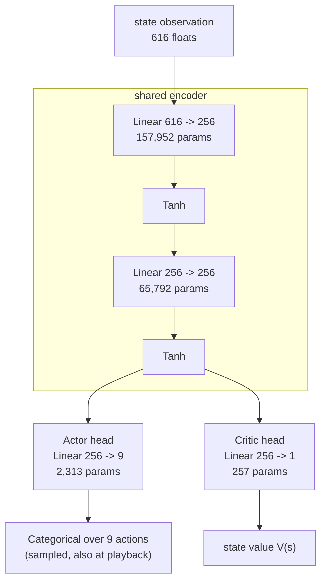
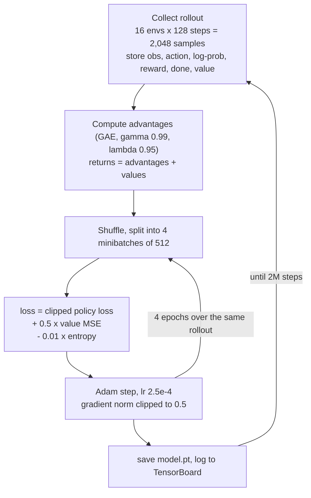
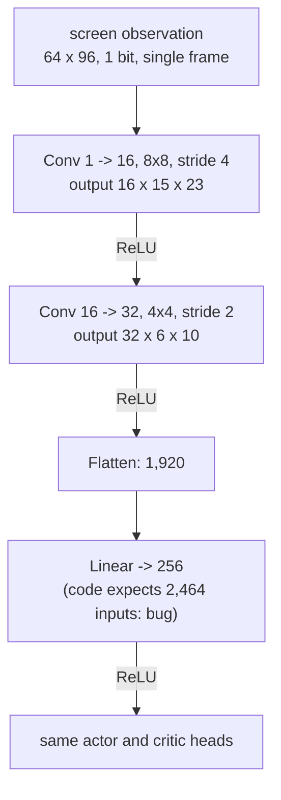

# Model architecture

The model is the `Agent` class in `scripts/train_ppo.py`: a shared encoder
feeding two linear heads (actor-critic). The trained model uses the MLP
encoder. About 226,000 parameters in total.

## Current model (state observation)

- Weights use orthogonal initialisation (gain sqrt(2) in the encoder, 0.01 on
  the actor, 1.0 on the critic).
- The actor and critic share the whole encoder; only the last layer differs.
- There is no memory (no recurrence, no frame stacking). Each decision uses
  the current observation only.
- Actions are sampled from the distribution during playback too, so the same
  model gives different episodes.

## How a PPO update flows

## Pixel variant (`--obs screen`, not yet working)

The script also defines a CNN encoder for the 64x96 1-bit screen. It has never
been trained, and it currently crashes on the first forward pass: the flatten
size is written as `32 * 7 * 11` (2,464) but the convolutions actually produce
`32 * 6 * 10` (1,920).

A single frame also hides motion (jump phase, which way a bubble is drifting),
so a working pixel setup would want frame stacking on top of the size fix.
