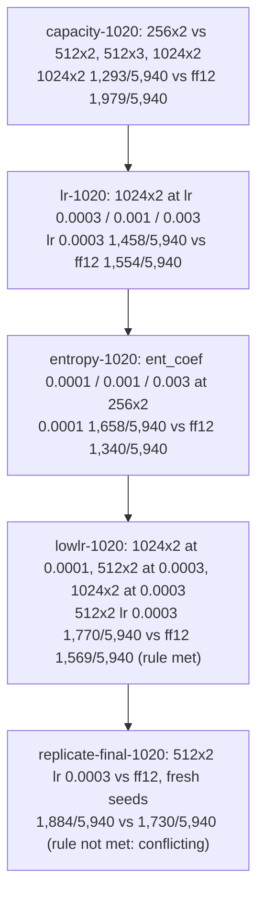

# Overnight experiments, October 19–20, 2026

Five registered rounds ran between 21:19 and 06:50. Fable did the implementation and execution;
Codex reviewed at its scheduled checks in `docs/fable-codex-progress.md` (with a recorded gap: no
separate reviews at 04:19 or 04:49). They ran under the user's overnight
authorization (`docs/experiment-direction-2026-10-19.md`, CODEX-20261019T205252-0700 and
CODEX-20261019T205553-0700). At 06:48 the user extended the work through 20:00 with a new
Codex-designed program on MLP 512×4 (`docs/daytime-search-2026-10-20.md`), which is not covered here.

## Bottom line (absolute)

**No recipe is close to solving the game.**

- **The test:** each of levels 1–99 started fresh, one life, 900 decisions of 60 simulated seconds,
  sampled actions.
- **The latest selected candidate:** its final result was **512×2 at lr 0.0003: 1,884 of 5,940 level
  attempts (31.7%)**, in replicate-final-1020. Its matched ff12 comparator, on the same seeds and bank,
  scored 1,730 of 5,940 (29.1%).
- **Across rounds,** with different seeds and banks, so not a matched comparison: the highest single
  final-bank total was ff12 256×2's **1,979 of 5,940 (33.3%)** in capacity-1020. ff12 ranged from
  **1,340 to 1,979 (22.6%–33.3%)** over the five rounds. That spread is comparable to most differences
  between recipes.
- **How attempts fail:** almost every failed attempt was a death; timeouts were about 0.1% or less. In
  the two lowlr-1020 galleries (one episode per level), most deaths came within the first 5–10
  simulated seconds.
- Five levels (63, 67, 71, 73, 85) were never cleared by any working recipe.

**The search outcome:**
- 512×2 at lr 0.0003 met the registered rule once (lowlr-1020) and failed it once on fresh seeds
  (replicate-final-1020, where one of three training seeds lost by 64.5 clears per 990).
- That is conflicting evidence awaiting Codex's review. ff12 was not automatically reinstated.
- The user has since fixed all future work to MLP 512×4.

*Corrected 2026-10-20 08:00 after Codex review (CODEX-20261020T072120-0700): "best final-bank result of the night" (ff12 scored 1,979 in capacity-1020), "as large as any difference" (capacity-1020's gap was larger), "highest totals ... in both rounds", and "Codex reviewed every 30 minutes" were wrong or too broad.*

## Rounds

Final-bank totals pool three training seeds × two evaluation seeds × 99 levels × 10 episodes = 5,940
attempts per arm.

| round | question | selected arm | selected: cleared / 5,940 | ff12 256×2: cleared / 5,940 | registered rule | allocated core-h |
|---|---|---|---|---|---|---|
| capacity-1020 | Do larger MLPs help with ff12's recipe? | 1024×2 (lr 0.001) | 1,293 (21.8%) | 1,979 (33.3%) | not met | 12.215 |
| lr-1020 | At 1024×2, does the learning rate matter? | 1024×2, lr 0.0003 | 1,458 (24.5%) | 1,554 (26.2%) | not met | 12.216 |
| entropy-1020 | At 256×2, does the entropy coefficient matter? | ent_coef 0.0001 | 1,658 (27.9%) | 1,340 (22.6%) | not met (one negative pair) | 12.201 |
| lowlr-1020 | Can a lower rate let a larger MLP beat ff12? | 512×2, lr 0.0003 | 1,770 (29.8%) | 1,569 (26.4%) | **met** | 12.207 |
| replicate-final-1020 | Does that hold on fresh seeds? | 512×2, lr 0.0003 | 1,884 (31.7%) | 1,730 (29.1%) | not met (one seed pair lost) | 6.157 |

**Registered rule:** final-bank mean paired gain of at least +30 per 990 and no negative training-seed
pair. It was the overnight operational decision rule, not a competence criterion. The user has since
directed that results be reported as totals, not increments.

**Cost:** 54.996 allocated single-thread core-hours across the five rounds: elapsed job time for
training, evaluation, preflight and gallery recording. That is within the 66.41 overnight ceiling. About
0.092 core-hours of round 5 fell after the 06:48:25 extension and is counted there. The MLflow service
used 230.3 CPU-seconds from 21:33 to 07:04, accounted separately.

## What the night supports

- **ff12's settings do not suit larger MLPs as they stand.** This is from capacity-1020.
- **The learning rate matters for larger MLPs.** Pooled over every evaluation file of the night
  (`docs/research-synthesis-2026-10-20.md`), 1024×2 completed 0%, 21.1%, 24.4% and 26.8% of attempts at
  lr 0.003, 0.001, 0.0003 and 0.0001. 512×2 completed 20.9% at lr 0.001 and 30.1% at 0.0003. These pool
  different rounds and seeds, so they are descriptive; they do not measure how much of any gap the
  learning rate caused.
- **512×2 at lr 0.0003 exceeded its matched ff12 comparator's total in both rounds it ran:** 1,770 against
  1,569 (29.8% against 26.4%) and 1,884 against 1,730 (31.7% against 29.1%). Its per-seed comparisons
  split: the registered rule was met in one round and not in the other.
- **Seed spread dominates.** The training seed is the replication unit, with three per round. The
  reference alone spanned 22.6%–33.3% of final-bank attempts across rounds.

## What it does not support

- **That any recipe is generally the strongest, or competent.** Each later round's candidate was chosen
  with knowledge of earlier final banks. Those banks are consumed for the overall search: valid records
  of their own frozen comparisons, but not untouched holdouts.
  - The banks: 83001–83002, 93001–93002, 84001–84002, 94001–94002, 85001–85002, 95001–95002,
    86001–86002, 96001–96002, 87001–87002, 97001–97002.
- **Causal claims about throughput or entropy.** Step counts differed between jobs in every round.
  Scheduling and behaviour-dependent simulation cost are possible contributors, and the design never
  isolated them.
- **Anything about transformers, longer training, or other game versions.** Every round used the
  `2aa2548-baron-timer` game (source hash `67eaeefe…`) and 60-minute training.
- **The joint gap.** 256×2 at lr 0.0003 was never trained on the current game, so width and learning
  rate are confounded in the 512×2 result.

The research synthesis (`docs/research-synthesis-2026-10-20.md`) gives the full coverage map,
per-level failure patterns, every seed's learning trajectory and ranked hypotheses.

## Execution and tracking

- **Tracking:**
  - MLflow was on for every job and nothing was left pending in the outboxes.
  - Each job's SQLite attempt row and its MLflow run reference each other.
  - Every evaluation is recorded with its full protocol, and the evaluator's reported protocol was
    checked against it.
  - Every round's experiment revision and runs were registered before training.
  - Each round after the first was pre-registered as a committed generator before the previous
    round's outcome.
- **Runner defect (capacity-1020, 22:20).** The budget check double-counted jobs that were still
  evaluating and refused wave 2 (never dispatched).
  - Fixed in `3e39cb2`.
  - The round resumed from a recorded runner snapshot that differs from the frozen snapshot only in
    `scripts/exptrack/campaign.py`.
  - Codex reviewed it.
- **Failure-path protections** (`948de80`, `02f0cba`) were added at Codex's request and deployed from
  round 3 on. None fired:
  - child-process identity and orphan refusal;
  - resuming evaluation instead of retraining;
  - budgeted, atomically reserved retries;
  - bounded preflight;
  - refusal when a cost is unknowable.
- **Hand-overs** between rounds took 73–80 s. The galleries and the next preflight ran concurrently,
  never with more than 3 workers.
- **Reviews.** Codex independently re-verified every round: checkpoints, raw evaluations, SQLite rows
  and MLflow states. Corrections it requested to report wording are recorded as dated notes in each
  report.

| round | SQLite experiment / revision | MLflow experiment | snapshot |
|---|---|---|---|
| capacity-1020 | `exp-d306503662b72eb4` / `rev-d3e10f3129a89c05` | 14 `capacity-1020` | `869109196a` (+ `runner-r2`) |
| lr-1020 | `exp-9b9ab42e33829c35` / `rev-fdca002cc996f9b5` | 19 `lr-1020` | `df69c19777` |
| entropy-1020 | `exp-a7f78e61fdc75b8a` / `rev-04950e1afbea0169` | 21 `entropy-1020` | `e7cc7070d8` |
| lowlr-1020 | `exp-cfb605dfe16331ea` / `rev-e5fea8af4ef4f35e` | 23 `lowlr-1020` | `5a2caa4fb6` |
| replicate-final-1020 | `exp-2b729e1bee51657b` / `rev-8d049ce428f6940c` | 25 `replicate-final-1020` | `92a854de77` |

## Reports and galleries

- **Reports:**
  - `docs/capacity-1020-results.md`
  - `docs/lr-1020-results.md`
  - `docs/entropy-1020-results.md`
  - `docs/lowlr-1020-results.md`
  - `docs/replicate-final-1020-results.md`

  Each leads with absolute final-bank totals.
- **Galleries** (catalogue `exports/index.html`): two new dated galleries per round, one unselected
  episode per level at each round's first training seed. Earlier versions are untouched. They are
  viewing artifacts, not estimates.
