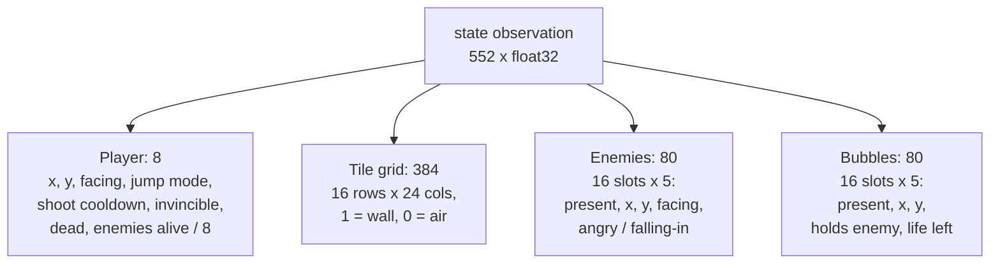
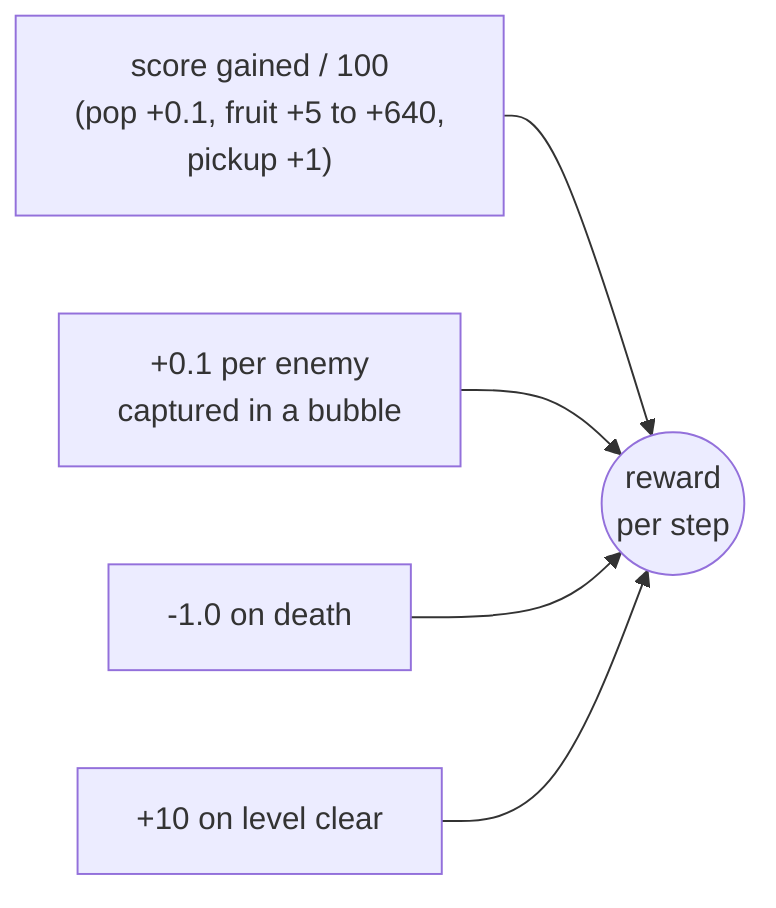

# What the agent is trained on

The current model (`runs/ppo_state_L1/model.pt`) was trained with
`scripts/train_ppo.py` at its defaults: PPO, the structured **state**
observation (not pixels), **level 1 only**, 2M agent steps.

## The interaction loop

The agent picks one action every 4 game frames, so it acts at 15 Hz.

## Observation: the 552-number state vector

Built in `BubbleBobbleEnv._obs` (`src/bubblebobblerl/env.py`). The agent never
sees the picture; it reads the game's internal state directly.

Things the game tracks that are **not** in the observation:

- Fruit dropped by dead enemies, and the two static pickups per level. Fruit is
  where most of the score comes from, and the agent cannot see it.
- Bubbles still in flight (the "prebubble" phase before they start floating).
- Air-current direction of each tile (only wall vs air is exposed).
- Enemy kind.

## Actions

`Discrete(9)`: NOOP, LEFT, RIGHT, JUMP, LEFT+JUMP, RIGHT+JUMP, SHOOT,
LEFT+SHOOT, RIGHT+SHOOT. Jump and shoot only fire on a fresh press, so holding
the same action across steps does not repeat them.

## Reward

## Episode lifecycle

One life and one level per episode. The agent has never seen levels 2 to 100
during training.

## Training run

| Setting | Value |
|---|---|
| Algorithm | PPO (clipped objective, GAE) |
| Parallel envs | 16 (`SyncVectorEnv`) |
| Rollout length | 128 steps, so 2,048 samples per update |
| Update | 4 epochs x 4 minibatches of 512 |
| Learning rate | 2.5e-4 (Adam, constant) |
| Discount / GAE lambda | 0.99 / 0.95 |
| Clip range | 0.1 |
| Entropy / value coefficients | 0.01 / 0.5 |
| Gradient clip | 0.5 |
| Total steps | 2,000,000 agent steps (8M game frames) |

## Results on level 1

| Policy | Mean return | Mean score | Level clears |
|---|---|---|---|
| Random | 1.46 | 185 | 1 / 20 |
| Scripted hunter | 3.58 | 230 | 4 / 20 |
| PPO, 2M steps | 23.05 | 1719 | 30 / 50 |

Return plateaued at about 400k steps. On the other 99 levels (never trained
on), a best-of-3 export cleared 15.
