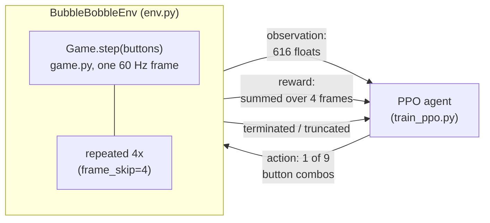
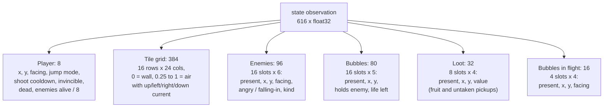
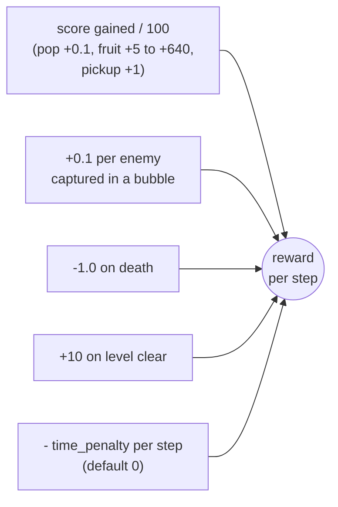
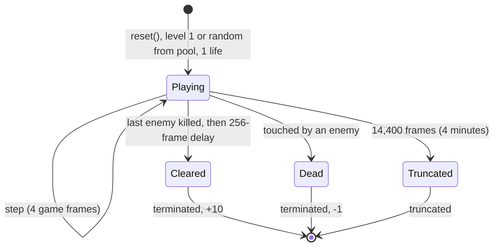
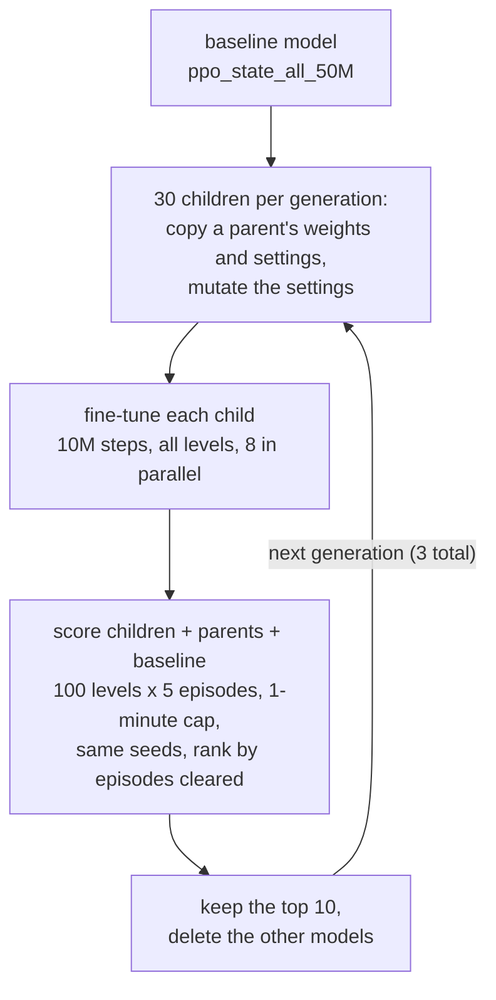

# What the agent is trained on

The best model so far (`runs/ppo_state_all_50M/model.pt`) was trained with
`scripts/train_ppo.py`: PPO, the structured **state** observation (not
pixels), a random level from all 100 each episode (`--levels 1-100`), time
penalty 0.002, 50M agent steps. Earlier models trained on level 1 only for 2M
steps; results for all of them are at the bottom.

## The interaction loop

The agent picks one action every 4 game frames, so it acts at 15 Hz.

## Observation: the 616-number state vector

Built in `BubbleBobbleEnv._obs` (`src/bubblebobblerl/env.py`). The agent never
sees the picture; it reads the game's internal state directly.

The first model (`runs/ppo_state_L1`, 552 inputs) had no loot, in-flight
bubbles, enemy kind or air currents. It no longer loads with the current env.
Still not in the observation: dead enemies mid-arc (about a quarter second
before they become fruit).

## Actions

`Discrete(9)`: NOOP, LEFT, RIGHT, JUMP, LEFT+JUMP, RIGHT+JUMP, SHOOT,
LEFT+SHOOT, RIGHT+SHOOT. Jump and shoot only fire on a fresh press, so holding
the same action across steps does not repeat them.

## Reward

Two optional knobs, both off by default: `time_penalty` (stands in for the
unimplemented hurry-up) and `reward_pops=False`, which stops paying the
10 points per bare bubble pop or bounce, since those can be farmed forever.

## Episode lifecycle

One life and one level per episode. With `levels=[...]` (script flag
`--levels 1-100`) each reset draws a level from the pool; otherwise every
episode is level 1.

## Training run

| Setting | Value |
|---|---|
| Algorithm | PPO (clipped objective, GAE) |
| Parallel envs | 16 (`SyncVectorEnv`) |
| Rollout length | 128 steps, so 2,048 samples per update |
| Update | 4 epochs x 4 minibatches of 512 |
| Learning rate | 2.5e-4 (Adam, constant) |
| Discount / GAE lambda | 0.99 / 0.95 |
| Clip range | 0.1 |
| Entropy / value coefficients | 0.01 / 0.5 |
| Gradient clip | 0.5 |
| Total steps | 2,000,000 agent steps (8M game frames) |

## Results on level 1

| Policy | Mean return | Mean score | Level clears |
|---|---|---|---|
| Random | 1.46 | 185 | 1 / 20 |
| Scripted hunter | 3.58 | 230 | 4 / 20 |
| PPO, 2M steps, 552-input obs (`ppo_state_L1`) | 23.05 | 1719 | 30 / 50 |
| PPO, 2M steps, 616-input obs (`ppo_state_L1_v2`) | 22.93 | 1660 | 32 / 50 |

The richer observation made no measurable difference on level 1.

## Results across all 100 levels

Best of 3 episodes per level, 600-step cap, from `scripts/export_levels.py`.
All runs are 2M steps.

| Model | Cleared | Died | Timed out |
|---|---|---|---|
| Level 1 only, old obs (`ppo_state_L1`) | 16 | 30 | 54 |
| All levels, time penalty 0.002 (`ppo_state_all`) | 0 | 61 | 39 |
| All levels, same, no pop reward (`ppo_state_all_nopop`) | 1 | 91 | 8 |
| All levels, time penalty 0.002, **50M steps** (`ppo_state_all_50M`) | 29 | 19 | 52 |
| Same model, greedy playback (`--greedy`) | 18 | 14 | 68 |
| All levels, 50M steps, decaying learning rate (`ppo_state_all_50M_anneal`) | 15 | 26 | 59 |

Multi-level training fails at 2M steps (about 20k per level) and works at
50M. The 2M `ppo_state_all` agent dies in the first seconds of most episodes;
removing the pop reward made it learn almost nothing, so pops are its main
early learning signal. The 50M agent also clears level 1 in 48 of 50 episodes,
better than the level-1 specialists. Its training return rose until about 16M
steps and then hovered around 50. Under training conditions (4-minute limit)
it clears 37 of 200 episodes, dies in 92 and runs out the clock in 71, so
finishing levels rather than surviving and collecting points is the remaining
weakness.

Decaying the learning rate (`--anneal-lr`) raised the reward but lowered the
clear rate: under training conditions the annealed agent averages a return of
61.9 against 55.4, yet clears 18 of 200 episodes against 37 and runs out the
clock in 97 against 71. It is better at what the reward pays for, which is
staying alive and collecting points for four minutes, not finishing levels.
Each configuration was run once, so differences this size are not firm.

Greedy playback (always the most likely action) does worse than sampling on
the same model, so sampling stays the default.

## Evolutionary fine-tuning (`scripts/evolve.py`)

Settings that mutate: clear bonus, time penalty, pop reward on/off, death
penalty, learning rate, entropy coefficient. Generation 1 also includes
hand-picked variants (clear bonus 30/100, time penalty 0.01/0.03, pops off,
and combinations).

Run `overnight1` (3 generations, about 3 hours, 890M steps):

| Generation | Best member (cleared / 500) | Baseline on the same seeds |
|---|---|---|
| 1 | 120 | 103 |
| 2 | 129 | 93 |
| 3 | 142 | 112 |

Those "best" figures are picked as the maximum of about 40 models, so they are
inflated. Re-scored on fresh seeds (100 levels x 10 episodes):

| Model | Cleared / 1000 | Died | Timed out | Levels cleared at least once |
|---|---|---|---|---|
| Baseline (`ppo_state_all_50M`) | 217 | 317 | 466 | 43 |
| Champion `g3m05` | 302 | 378 | 320 | 48 |
| Runner-up `g3m15` | 268 | 349 | 383 | 48 |
| Third `g3m21` | 245 | 335 | 420 | 45 |

The champion is at `runs/evolve/overnight1/gen_03/g3m05/model.pt`.

What the search found:

- The winning line kept the baseline reward unchanged. Its only mutation was
  a lower learning rate (1.5e-4 instead of 2.5e-4), followed by two unmutated
  continuations. 8 of the final 10 survivors descend from that one
  generation-1 child.
- Turning the pop reward off was consistently among the worst choices
  (39 to 71 of 500), and a clear bonus of 100 on its own also did badly (42).
- A steep time penalty (0.03) won generation 1 but did not keep up. One
  line with clear bonus about 32 and time penalty 0.01 survived to the end; it
  times out least but dies most.
- So the earlier guess that the reward settings were the bottleneck was not
  borne out: more training at a lower learning rate, plus selection, gave the
  gain.

One generation-3 child failed when the disk filled up; it was skipped.

Generations 4-6 (run the next day, about 3.5 hours more):

| Generation | Best member (cleared / 500) | Baseline on the same seeds |
|---|---|---|
| 4 | 156 | 104 |
| 5 | 158 (still `g3m05`) | 100 |
| 6 | 163 | 109 |

On the fresh seed set used above (100 levels x 10 episodes), the later
survivors are no better than `g3m05`: `g6m16` 298, `g6m06` 316, `g4m11` 298
against `g3m05` 302 and the baseline 217. Three more generations bought
nothing measurable; the search has plateaued at about 30% of episodes.
`docs/analysis.md` explains why: every one of these agents plays the same
stationary strategy, and the plateau is that strategy's ceiling.
